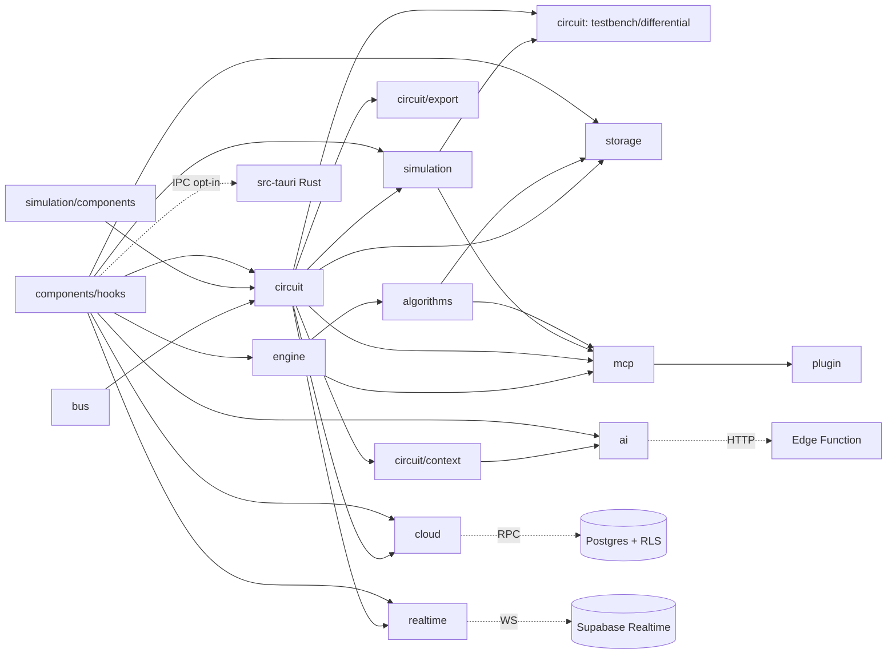

# Arquitetura do sistema

> Mapa real dos componentes e das dependências. Legenda em [`../README.md`](../README.md).
> Arquitetura futura proposta (compilador de IR, runtime event-driven, 25k chips) está em
> `docs/VERITAS_25K_SCALABLE_ARCHITECTURE.md` e é `PLANNED`.

## 1. Visão de camadas (estado atual)

```text
┌──────────────────────────── Superfícies ─────────────────────────────┐
│ Web/PWA (React 19)   Desktop Tauri 2   MCP stdio   MCP HTTP   Plugin │
└──────┬───────────────────┬──────────────┬───────────┬──────────┬─────┘
       │                   │ (WebView)    │           │          │ (server.mjs empacotado)
┌──────▼───────────────────▼──────────────▼───────────▼──────────▼─────┐
│ Adaptadores de aplicação                                              │
│  components/ + hooks/ (UI)     mcp/src/tools.ts (headless)            │
│  cloud/  realtime/  ai/  auth/  metrics/  (opt-in, Supabase)          │
└──────┬────────────────────────────────────────────────────────────────┘
       │ importam, sem DOM
┌──────▼────────────────────────── Domínio TypeScript (canônico) ──────┐
│ engine/   circuit/   simulation/   bus/   algorithms/   chips/        │
│ storage/ (Dexie + envelopes de arquivo)                               │
└──────┬───────────────────────────────┬───────────────────────────────┘
       │ contratos de dados            │ contratos de dados
┌──────▼──────────────┐   ┌────────────▼──────────────┐   ┌──────────────────────┐
│ Supabase (Postgres, │   │ src-tauri (Rust):          │   │ engine-rs (Rust):     │
│ RLS, RPC, Realtime, │   │ simulate_circuit_native    │   │ avaliador comb. +     │
│ Edge Function IA)   │   │ EXPERIMENTAL, fora da UI   │   │ ABI WASM EXPERIMENTAL │
└─────────────────────┘   └────────────────────────────┘   └──────────────────────┘
```

Regra estrutural mais importante, confirmada no código: **o domínio (`engine`, `circuit`,
`simulation`, `bus`, `algorithms`) não importa React nem DOM**. É isso que permite o mesmo
código rodar na UI, no MCP, em Worker e no importador de chips.

## 2. Componentes

| Componente | Responsabilidade | Arquivos-chave | Estado | Depende de |
| --- | --- | --- | --- | --- |
| **Engine booleana** | Lexer, parser, AST, avaliação com passos, tabela, minimização, formas normais, Karnaugh | `src/engine/*` | `IMPLEMENTED` | — |
| **Bus** | `BitVector` (1–64 bits), conversões binário/hex | `src/bus/bitVector.ts` | `IMPLEMENTED` | — |
| **Modelo de circuito** | `CircuitDocument`, validação, normalização, limites, topologia, netlist | `src/circuit/editorModel.ts`, `documentContract.ts`, `documentLimits.ts`, `topology.ts` | `IMPLEMENTED` | simulation/components, bus |
| **Avaliação combinacional** | Escalar e vetorial; tabela verdade | `src/circuit/evaluate.ts`, `truthTable.ts` | `IMPLEMENTED` | modelo, topology |
| **Chips** | Definição, instância, elaboração hierárquica, portas, importação DLS, catálogo | `src/circuit/customChip*.ts`, `dlsImport.ts`, `src/chips/*` | `IMPLEMENTED` | modelo |
| **Verificação** | Equivalência, comparação temporal, testbench, identidade de portas | `src/circuit/equivalence.ts`, `differential.ts`, `testbench.ts`, `portIdentity.ts` | `IMPLEMENTED` | avaliação, simulation |
| **HDL** | Verilog/VHDL | `src/circuit/export.ts` | `PARTIAL` (K-02) | modelo, chips |
| **Simulação** | `Simulator` (duas fases, budgets, async, cancelamento), `documentRuntime`, waveform | `src/simulation/simulator.ts`, `documentRuntime.ts`, `waveform.ts` | `IMPLEMENTED` | components |
| **Execução isolada** | Protocolo Worker v1, cliente, supervisor, executor documental, checkpoint, cliente Tauri | `src/simulation/worker*.ts`, `documentWorker*.ts`, `tauriSimulationClient.ts` | `EXPERIMENTAL` | simulation |
| **Algoritmos** | `AlgorithmDocument`, validação, expressões restritas, executor, casos lógicos | `src/algorithms/*` | `IMPLEMENTED` | engine (casos lógicos) |
| **Storage local** | Dexie v5 e 5 envelopes de arquivo | `src/storage/*` | `IMPLEMENTED` / `PARTIAL` (K-01) | domínio |
| **UI** | App, editor, painéis, workspaces lazy, boundaries | `src/App.tsx`, `src/components/*` (30 arquivos; `CircuitEditor.tsx` 1832 linhas) | `IMPLEMENTED` | tudo acima |
| **Auth** | Sessão Supabase opcional | `src/auth/*`, `src/lib/supabase.ts` | `IMPLEMENTED` (opt-in) | Supabase |
| **Cloud** | Projetos, versões, diff, conflito | `src/cloud/*` | `PARTIAL` (G-02) | Supabase RPC |
| **Realtime** | Rooms, Presence, Broadcast, ordenação, runtime offers | `src/realtime/*` | `PARTIAL` | Supabase Realtime |
| **IA** | Cliente da Edge Function, contexto determinístico, métricas | `src/ai/circuitAi.ts`, `src/circuit/context.ts`, `src/metrics/*` | `PARTIAL` (G-03) | Edge Function |
| **MCP** | Ferramentas puras + registro Zod + transportes | `mcp/src/tools.ts`, `server.ts`, `stdio.ts`, `http-server.ts` | `IMPLEMENTED` (stdio) / `EXPERIMENTAL` (HTTP) | domínio |
| **Plugin** | Marketplace, manifesto, `.mcp.json`, skill, bundle versionado | `.claude-plugin/`, `plugins/veritas-logic/` | `IMPLEMENTED` (desatualizado — G-06) | MCP |
| **Supabase** | 14 migrations: tabelas, RLS, RPC, validação SQL, Realtime policies; Edge Function | `supabase/` | `IMPLEMENTED` (deploy `UNKNOWN`) | — |
| **Tauri** | Shell desktop, comandos nativos de simulação e smoke | `src-tauri/src/lib.rs`, `simulation.rs` | `EXPERIMENTAL` | Rust |
| **engine-rs** | Avaliador combinacional, ABI WASM `VNET/VRES`, benchmarks | `engine-rs/src/*` | `EXPERIMENTAL` | Rust |
| **Release eng.** | Contratos de aceitação `.mjs`+`.d.mts`, agregador de evidência, guard | `scripts/*`, `src/release/*.test.ts` | `IMPLEMENTED` | — |

## 3. Dependências entre componentes



Observações:

- `circuit` e `simulation` se referenciam mutuamente em nível de tipos (`ComponentType`,
  `PortRef` vêm de `simulation/components.ts`; `documentRuntime` consome `CircuitDocument`).
  É um acoplamento aceitável hoje, mas relevante para a modularização planejada (v3.0.0).
- `mcp/src` importa diretamente `../../src/...`; não há pacote de domínio publicado.
- Rust **não** é dependência de nenhuma superfície em produção.

## 4. Fluxos principais

| Fluxo | Caminho | Pontos de validação |
| --- | --- | --- |
| Expressão | texto → `lex` → `parse` → AST → `buildTruthTable` / `simplify` → UI/MCP | Parser com erro posicional |
| Edição de circuito | React Flow → `toDocument` (no editor) → `CircuitDocument` → `validateCircuit` → avaliação/tabela | `normalizeCircuitDocument`, `validateCircuit`, limites |
| Simulação | `CircuitDocument` → `preflightDocumentRuntime` → `toNetlist` → `Simulator` → snapshots | Preflight de ciclos, budgets |
| Verificação | 2 documentos ou documento + testbench → avaliação/simulação → relatório com força + contraexemplo | Identidade de portas, limites de bits/tiques/casos |
| Persistência local | documento → validação → Dexie (transação) ; arquivo → parser fail-closed → validação → transação | Envelopes versionados, chaves permitidas, 5 MB |
| Nuvem | documento → guard + `validateCircuit` → RPC `veritas_sync_circuit_project` (`p_base_version`) → SQL `private.veritas_validate_circuit_document` → RLS | 3 camadas com regras diferentes (G-02) |
| IA | documento → `buildCircuitContext` (hash FNV) → Edge Function (Bearer + guard próprio) → LLM ou heurística → guard + `validateCircuit` no cliente → botão "Aplicar" | Sem checagem comportamental (G-03) |
| Colaboração | snapshot → Broadcast privado → ordenação (`baseVersion`, `sentAt`, `clientId`, `hash`) → oferta → usuário aplica → `validateCircuit` | Guard só de forma na recepção |
| MCP | JSON-RPC → Zod (forma) → `tools.ts` → guard de documento + validação de domínio → JSON em texto | Ver [`MCP_ARCHITECTURE.md`](../04-DEVELOPER/MCP_ARCHITECTURE.md) |

## 5. Targets de build e distribuição

| Target | Config | Saída | Distribuição |
| --- | --- | --- | --- |
| App web/PWA | `vite.config.ts` | `dist/` | Vercel (URL de smoke em `docs/BETA-EVIDENCE-MANIFEST.md`) |
| Biblioteca da engine | `vite.lib.config.ts` | `dist-lib/veritas-engine.js` (só `src/engine`) | Uso interno pelo importador de chips |
| MCP stdio | `vite.mcp.config.ts` | `mcp/dist/server.js` | Local (`claude mcp add …`) |
| MCP HTTP | `vite.mcp-http.config.ts` | `mcp/dist/http-server.js` | Local, experimental |
| Plugin | `vite.plugin.config.ts` | `plugins/veritas-logic/server.mjs` + `catalog.json` **versionados no git** | Marketplace do Claude Code a partir do repositório |
| Desktop | `src-tauri/`, workflows `desktop-*.yml` | `.deb`, `.AppImage`, `Veritas-Setup.exe`, `.dmg`, `SHA256SUMS`, manifesto | GitHub Release `desktop-v0.1.0-alpha.1` |
| Rust | `engine-rs/Cargo.toml` | rlib/cdylib/wasm32 | Não distribuído |

## 6. Testes e qualidade

- Vitest: 92 arquivos / 814 testes [verificado]; co-localizados em `src/**`, `mcp/src/**`,
  `tests/regression` (cross-runtime expressão × circuito), `tests/benchmarks`, `tests/desktop`.
- Rust: `cargo test` em `engine-rs` (via `beta:rust` no CI); testes do crate `src-tauri` **não**
  rodam no workflow `quality.yml` [código].
- CI (`quality.yml`): testes, Rust, WASM readiness/paridade/isolamento, benchmarks, typecheck,
  lint, builds (web, MCP stdio/HTTP, plugin), gates `beta:*` locais, HDL com `iverilog`/`ghdl`,
  smoke PWA. Detalhes em [`DEVELOPER_TOOLING.md`](../04-DEVELOPER/DEVELOPER_TOOLING.md).
- Não há threshold de cobertura nem suíte E2E de navegador como gate principal.

## 7. Hotspots de manutenção

| Hotspot | Por quê |
| --- | --- |
| `src/components/CircuitEditor.tsx` (1832 linhas) | Concentra adaptação React Flow, persistência, colaboração, runtime, IA, histórico e renderização |
| `src/chips/catalogVector.ts` (1562 linhas) | Allowlist DLS escrita perfil a perfil |
| `mcp/src/tools.ts` (1192 linhas) | Adaptador único para todas as ferramentas |
| Regras de aceitação de documento | Repetidas em ≥7 lugares (ver [`DUPLICATIONS.md`](./DUPLICATIONS.md)) |
